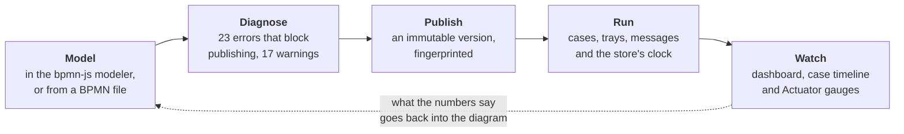
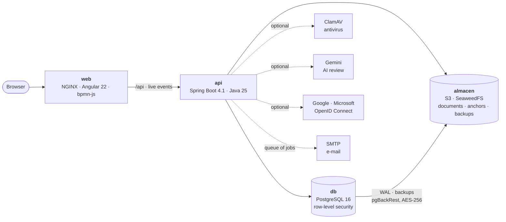
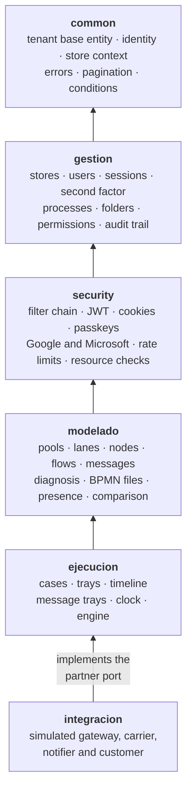

# BPMN Process Manager API

**Model, validate and run the workflows behind every online order.**

BPMN Process Manager is a multi-tenant platform where online stores draw how their orders move — from checkout to
delivery, payments and returns — as BPMN process diagrams, and then run them. Each store works in a private
workspace, with its processes filed in folders and permissions down to a single process. Diagrams are drawn in a
bpmn-js modeler or brought from any other tool as BPMN 2.0.2 files, every change is validated and recorded, and a
published diagram becomes an immutable version that orders run on. This repository holds the REST API and the
Angular web app built on it.

[](https://github.com/AndresContreras1/bpmn-process-manager-api/actions/workflows/ci.yml)


[](LICENSE)

> [!NOTE]
> Orders run on a clock made of ticks that somebody moves on purpose, against simulated partners. Nothing here calls
> a real payment provider or carrier, and that is the point: the same store, the same seed and the same steps always
> decide the same way, so a demo and a test can be replayed exactly.

## Contents

[What it does](#what-it-does) · [Features](#features) · [Architecture](#architecture) ·
[Quick start](#quick-start) · [Documentation](#documentation) · [Quality](#quality) ·
[Project structure](#project-structure) · [Roadmap](#roadmap) · [License](#license)

## What it does



A store draws its process, or imports it from Camunda Modeler, bpmn.io or any tool that writes BPMN 2.0, the
diagnosis refuses to publish one that would not run, and publishing freezes the diagram into a version. From then on an order is a case walking that exact version: it stops where a person has to
act, sends what the diagram says it sends, waits for the answer, and closes. Publishing again does not move an
order that is already running — it finishes on the diagram it started with.

The [overview](docs/overview.md) explains the problem it solves, the key concepts and the guarantees it gives, and
the [order-fulfillment example](docs/example-order-fulfillment.md) walks the demo store's process step by step.

## Features

| Area | What you get | Details |
|---|---|---|
| **Modeling** | Participants, lanes, tasks, gateways, events with timers and boundary events, sub-processes and call activities, sequence and message flows, correlation keys, and annotations, groups and data objects. A process is executable or only documents. Every change is checked against the BPMN rules, so a model never ends up in an invalid state. | [Domain model](docs/domain-model.md) |
| **BPMN 2.0.2 files** | Export a process or any of its versions as a file that validates against the OMG schemas and opens in bpmn.io and Camunda Modeler. Import from any tool by differences, element by element, with a report of what was converted, what was left out and what was kept to write it back. A fuzzer feeds the importer every night. | [BPMN files](docs/api-reference.md#endpoints) |
| **Editing together** | Autosave of the whole model with `ETag` and `If-Match`, draft revisions to go back to, who is on a process over server-sent events shared by every replica, a soft lock with *take control*, and a comparison by meaning between versions, the draft or a file that was not saved. | [Concurrent edits](docs/api-reference.md#concurrent-edits) |
| **Diagnosis** | A deterministic catalogue of 23 errors and 17 warnings, each pointing at an element, and a what-if that says what a deletion would take with it. | [Diagnosis](docs/diagnosis-and-versions.md#diagnosis) |
| **Versions** | Publishing freezes the whole diagram with a SHA-256 fingerprint and keeps its BPMN file, the same bytes forever. What is edited afterwards is the draft, and the process says when it is ahead. | [Versions](docs/diagnosis-and-versions.md#published-versions) |
| **Documents** | Files attached to a process or one of its elements, with versions. The type comes from the content against a whitelist, an antivirus and a ZIP bomb check review each one in the job queue, each store has a quota, and a download is a five-minute signed link that always arrives as an attachment. Stored in S3 or any compatible service. | [Documents](docs/security.md#documents) |
| **Documentation** | Markdown for the process and each of its elements, converted and cleaned on the server, a characterization sheet, and a manual of each published version in HTML and PDF, in the reader's language, with the drawing the modeler sent when publishing. | [Documentation](docs/api-reference.md#documentation-and-the-manual) |
| **Comments and notifications** | Threads on a process, one of its elements or a version, with replies and mentions of who can view it, resolved and reopened. A notification center only its recipient sees, live over server-sent events shared by every replica, and e-mail in each person's language, at once or in a daily digest, as each one chooses. | [Comments and notifications](docs/api-reference.md#comments-and-notifications) |
| **Repository** | A tree of folders, and for each process its owner, the date of its next review, how reserved it is and its tags, all of them filters of the list. | [The process repository](docs/api-reference.md#the-process-repository) |
| **Permissions** | Actions granted on a folder or a process — view, comment, model, review, approve, publish, export and administer — to a person, a process role or the whole store, inherited down the folders. The access role sets the ceiling, separation of duties goes last, and a list only shows what each person can see, in the same query. | [Permissions](docs/security.md#permissions-on-folders-and-processes) |
| **Execution** | Cases that walk a published version, tasks waiting in the tray of each process role, and gateway conditions in a small language of its own that cannot run code. | [Execution](docs/execution.md#running-a-process) |
| **Time and calendars** | Timers that run — waits, boundary timers that interrupt or only warn, and timer starts that open cases — counted on the wall clock with each organization's business calendar: working hours, and the public holidays of Colombia, the United States, France and Australia, computed and editable. They fire once, also with two replicas or after the API was down. Test cases keep the ticks, and a draft can be tried without publishing it. | [Time](docs/execution.md#time-production-and-test-cases) |
| **Assignment and inboxes** | A task reaches its role's tray, a fixed person, whoever opened the case or the person a form field names, frozen in the version. Claim, release, reassign and delegate with a reason, each in the case timeline and the audit trail; only the holder completes it, and two people claiming it at once cannot both get it. Inboxes for what is mine, my roles' and nobody's, and the workload per person. | [Assignment](docs/api-reference.md#assignment-and-inboxes) |
| **Deadlines and escalation** | A deadline on each user task and on the whole case, in hours or business days of the organization's calendar. On time, due soon and overdue, with a notice once at each change to whoever has the task and the process owner, a boundary timer that escalates to a supervisor, compliance per process, activity and person in the dashboard, and inboxes ordered by due date. | [Deadlines](docs/api-reference.md#deadlines-and-escalation) |
| **Forms** | Typed forms on user tasks and start events — text, numbers, money, dates, yes/no, lists, people, files and sections — with required fields, limits and RE2 patterns that cannot hang the server, fields that show or become required by a condition the server compiles for the web, and defaults from the case. Frozen in the version, carried in BPMN, and checked by the server on every answer, field by field. | [Typed forms](docs/api-reference.md#typed-forms) |
| **Messaging and simulation** | Outbox and inbox per process, correlation by key, a clock in ticks per store, and four simulated partners — payments, carrier, notifications, customer — deterministic by seed. | [Simulation](docs/execution.md#messages-and-the-clock) |
| **Dashboard** | Cases by state, cycle time with average and p95, work waiting per role, what did not go as expected, and deadline compliance per process, activity and person, in ten queries however many orders there are. | [Dashboard](docs/execution.md#the-dashboard) |
| **Operations** | Health probes, Prometheus metrics on a management port of their own with business counters, JSON logs, OpenTelemetry traces, and a request id in every response, log line and error. | [Operations endpoints](docs/getting-started.md#operations-endpoints) |
| **Backup and recovery** | Every WAL segment archived within a minute and a full backup every week with daily differentials, by pgBackRest, encrypted, into a bucket with Object Lock that the database's own keys cannot empty; documents with versions. A drill every month restores into an empty container and checks the rows of every table, every audit trail and every version fingerprint, and measures the RPO and the RTO. | [Backup and recovery](docs/runbook.md#backup-and-recovery) |
| **Sign-in** | The session in `HttpOnly` cookies with a CSRF token, a short-lived JWT with rotating refresh tokens, and idle and maximum limits each store chooses. Passwords as NIST SP 800-63B-4 asks, a second factor with an authenticator app or a passkey and recovery codes that each store can require, signing in without a password with a passkey, and signing in with Google or Microsoft, where an account is linked only after its owner confirms it. | [Authentication](docs/security.md#authentication) |
| **Security** | Store isolation enforced twice: by the build and by row-level security in PostgreSQL, under a role that cannot bypass it. Rate limits in token buckets every instance shares, an audit trail per store chained with SHA-256 that nobody can change and anchored every day where nobody can delete it, every permission decided by one evaluator, read-only sharing between stores, BPMN files read with hardened XML parsers, and closing a store or anonymizing a person that really deletes. | [Security](docs/security.md) |
| **E-mail** | Verifying the e-mail, recovering the password and inviting by e-mail, in Spanish, English and French, with links that work once. Sent over any SMTP server from a queue of jobs that retries. | [Links sent by e-mail](docs/api-reference.md#links-sent-by-e-mail) |
| **API contract** | OpenAPI for every operation, Problem Details errors, optimistic locking, idempotency keys and stable pagination. | [API reference](docs/api-reference.md) |
| **AI review** | An optional second opinion from a language model, answered in a validated schema and limited per store. It only advises. | [AI review](docs/diagnosis-and-versions.md#ai-review) |
| **Web app** | Angular client for all of it, in Spanish, English and French, light or dark: the bpmn-js modeler with live diagnosis and a structure view that edits without a mouse, who else is editing, the comparison of two states, viewers for versions and cases, the repository, account security, administration, cases, tasks, clock and dashboard. | [frontend/](frontend/README.md) |

## Architecture



The browser only talks to the web container: NGINX serves the app and forwards `/api` inside the network, so there
is no API URL baked into the build and no CORS to configure. Who is on a process reaches the browser as
server-sent events, and the replicas tell each other through PostgreSQL's `LISTEN/NOTIFY`, so several instances
need nothing besides the database. The database sends every change, encrypted, to a bucket of its own that its keys
cannot empty, and a drill restores it every month. Every outside service is optional: without its
configuration the API starts and the feature is simply not offered. Inside the API, the code is split into modules
that only depend downwards:



Each module is layered as controller → service interface → implementation → repository → entity, with DTOs and
MapStruct mappers at its edge. ArchUnit fails the build if an arrow points backwards, if a service reads without the
store's id, or if a request DTO carries one, and Spring Modulith if a module uses another one it did not declare.

| Layer | Technology |
|---|---|
| Backend | Java 25 · Spring Boot 4.1 · Spring Security 7 (JWT, OAuth2 client) · Spring Data JPA · Hibernate 7.4 · MapStruct · Spring Modulith · Bucket4j · AWS SDK v2 (S3) · Apache Tika |
| Data | PostgreSQL 16 in `prod`, in `dev` and in the tests, with row-level security, timeouts per role, an index behind every foreign key and `pg_stat_statements` · Flyway migrations, validated by Hibernate · HikariCP with leak detection · pgBackRest |
| Frontend | Angular 22 standalone · bpmn-js 18 · Bootstrap 5 · RxJS · NGINX · ESLint · Prettier · Vitest |
| Quality | JUnit 5 · Mockito · ArchUnit · Spring Modulith · Testcontainers · Selenium · axe-core · k6 · JaCoCo · PIT · SonarCloud |
| Delivery | Docker multi-stage images · Docker Compose · GitHub Actions |

[Architecture](docs/architecture.md) covers the request lifecycle, the module boundaries and the published-version
cache; [Design decisions](docs/design-decisions.md) explains the choices behind them.

## Quick start

**The API with demo data** (JDK 25 and Docker running):

```bash
./mvnw spring-boot:run
```

It starts on `http://localhost:8080` with the `dev` profile: Spring Boot brings up a PostgreSQL 16 from
`compose.dev.yaml` and *Demo Store* is seeded with a published order-fulfillment process. Swagger UI is at
`/swagger-ui.html`.

**The web app** (Node.js 22+), in a second terminal:

```bash
cd frontend
npm ci
npm start
```

It opens on `http://localhost:4200` and forwards `/api` to the API.

| Demo account | Email | Password |
|---|---|---|
| Demo Store administrator | `admin@demo.com` | `every-order-on-time` |

**The whole stack**, database with its backups, storage, API and web, closer to production:

```bash
cp .env.example .env     # DB_PASSWORD, JWT_SECRET, MFA_CLAVE_DE_CIFRADO, ALMACEN_S3_CLAVE and RESPALDO_CLAVE have no default
docker compose up -d --build --wait
```

The app is then on `http://localhost`. This stack runs the `prod` profile and starts empty: register a store from
the app and its account becomes the first administrator. [Getting started](docs/getting-started.md) has the first
requests with curl, the Postman collection, the end-to-end tests and the operations endpoints, and
[Configuration](docs/configuration.md) lists every environment variable.

## Documentation

| | |
|---|---|
| **Product** | [Overview](docs/overview.md) · [Example: order fulfillment](docs/example-order-fulfillment.md) |
| **Running it** | [Getting started](docs/getting-started.md) · [Configuration](docs/configuration.md) · [Runbook](docs/runbook.md) |
| **How it works** | [Domain model and rules](docs/domain-model.md) · [Diagnosis, versions and AI review](docs/diagnosis-and-versions.md) · [Execution and simulation](docs/execution.md) · [Security](docs/security.md) · [API reference](docs/api-reference.md) |
| **Engineering** | [Architecture](docs/architecture.md) · [Quality and testing](docs/testing.md) · [Design decisions](docs/design-decisions.md) · [Decision records](docs/adr/README.md) · [Roadmap](docs/roadmap.md) |
| **Clients** | [Web app](frontend/README.md) · [End-to-end tests](e2e/README.md) · [Postman collection](postman/) |

## Quality

```bash
./mvnw verify
```

- **3728 tests** in the build, every one of them against PostgreSQL 16 with Testcontainers: architecture rules,
  controller and repository slices, service units, security and store isolation — permissions included, as a matrix
  of six people, eight actions and five resources — and integration across modules.
- **Coverage gate** with JaCoCo: 96 % of lines and 89 % of branches today, and the build fails below 90 % and 80 %
  in the service packages, where the business rules live.
- **Mutation testing** with PIT over the services, the engine and the conditions: 91 % of 3274 mutations caught,
  run every night with a floor of 75 %, and a **fuzzer** that feeds the BPMN importer broken files every night after
  it. Spotless keeps the imports and the whitespace of every changed file in order.
- **The web app** has 127 Vitest tests over its logic — the rules of the modeler, the tree of the structure view, the
  autosave, the live connection — and 27 Selenium scenarios, with axe-core over every screen.
- **Every pull request** runs nine jobs: build and test on Ubuntu and Windows, architecture rules, Docker image
  with k6 load tests, SonarCloud quality gate, frontend build, web image with the whole stack, Selenium end-to-end
  tests against it, the format check and the supply chain checks; CodeQL runs beside them. Every month a **restore
  drill** backs up a stack the order peak filled, restores it into an empty container and verifies it.
- **Supply chain**: every action pinned to a commit SHA, Dependabot, CodeQL, gitleaks over every commit, Trivy over
  the API, web and database images, and a CycloneDX SBOM of the API and the web. [Supply chain](docs/security.md#supply-chain)
  has the detail.

[Quality and testing](docs/testing.md) breaks every suite down.

## Project structure

```text
├── src/main/java/…/procesos   the API: common · security · gestion · modelado · ejecucion · integracion
├── src/main/resources         profiles, Flyway migrations and the BPMN schemas
├── src/test                   unit, slice, integration and architecture suites, all on PostgreSQL
├── frontend/                  Angular web app on bpmn-js and its NGINX image
├── e2e/                       Selenium end-to-end suite, a separate Maven module
├── k6/                        load tests: a sales peak and an order peak
├── ops/respaldo/              PostgreSQL with pgBackRest: backups, restore and the monthly drill
├── postman/                   collection that tours the API end to end
├── docs/                      the detailed documentation
├── compose.yaml               db, api, web, storage and backups
└── Dockerfile                 multi-stage image of the API: JRE 25 on Alpine, AOT cache, non-root user
```

## Roadmap

Modeling, execution, simulation, observability and the security of accounts and data are done, and so are BPMN
files in both directions, editing with others, the repository of processes and its permissions. What is still
open:

- A screen to grant permissions on folders and processes; today they are granted through the API.
- Comments with mentions, review and approval, and full-text search.
- Exporting a store's data during the 30 days of its closing.
- An AI review of a change instead of the whole diagram, so the model only reads what moved.
- HSTS preload, a month after production runs on HTTPS.

The [roadmap](docs/roadmap.md) lists every item, done and open.

## License

[MIT](LICENSE). Use it, read it, take what is useful.
